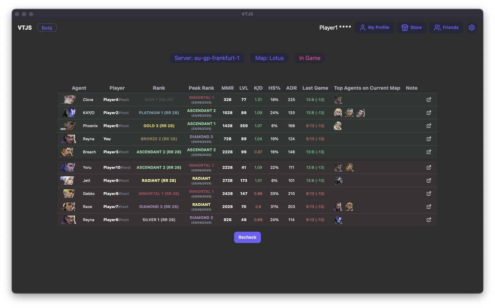

# VTJS - Valorant Companion App


A desktop companion application for Valorant that provides real-time match analysis, player statistics, and enhanced gaming insights.

## 🎯 What is VTJS?

VTJS is a desktop application built with Tauri and React that connects to your Valorant client to provide detailed information about your current matches, teammates, and opponents. It's designed to enhance your gaming experience by giving you valuable insights about players in your lobby.



## ✨ Features

### 🔍 **Real-time Match Analysis**
- Automatically detects when you're in a match (Agent Select or In-Game)
- Displays comprehensive player information for all teammates and opponents
- Shows current rank, peak rank, MMR, and recent performance statistics

### 📊 **Player Statistics**
- **Rank Information**: Current rank, peak rank, and rank rating (RR)
- **Performance Metrics**: K/D ratio, headshot percentage, average damage per round (ADR)
- **Agent Performance**: Top-performing agents on the current map
- **Match History**: Recent game results and MMR changes
- **Account Level**: Player account level and progression

### 🎮 **Match Insights**
- **Team vs Enemy MMR Comparison**: See the average MMR difference between teams
- **Map Information**: Current map and game server details
- **Smurf Detection**: Identifies potential smurf accounts based on performance patterns
- **Avoid List**: Track players you want to avoid in future matches

### 🛍️ **Store Integration**
- View current weapon skin offers with countdown timers
- Browse available accessories (sprays, buddies, player cards)
- Track store rotation schedules

### 👥 **Friends Management**
- See which friends are currently online in Valorant
- View friend activity and current game status
- Quick access to friend profiles and statistics

### ⚙️ **Settings & Customization**
- Optional analytics to help improve the application
- Privacy-focused design with local data storage
- Automatic updates for the latest features

## 🚀 Getting Started

### Installation
1. Download the latest release from the releases page
2. Install the application anywhere on your system
3. Launch VTJS (Ensure you are logged into your account)
4. The app will automatically connect and start providing match insights

## 🧪 Development

Requires the Rust toolchain and Bun.

```bash
bun install
bun run tauri dev      # real mode: connects to your Riot client
bun run test           # vitest
bun run build          # tsc + vite build
```

### Mock mode (no Riot client needed)

Set `VITE_FROM_JSON=true` (in `.env` or inline) and restart the dev server:

```bash
VITE_FROM_JSON=true bun run tauri dev
```

In mock mode:

- `LocalAPI` and `SharedAPI` are the real classes, but every HTTP request is answered from `src/mocks/fixtures/` through `src/mocks/router.ts`. Caching, auth and rate-limit code paths still run.
- Match detection is driven by synthetic `ws_message` events instead of the Riot websocket.
- The mock WS driver is exposed as `window.vtjsMock` (plus buttons on the `/test` page):

```js
vtjsMock.menus();
vtjsMock.pregame();
vtjsMock.ingame();
vtjsMock.presence({ sessionLoopState: "INGAME", partyId: "test-party-id", partySize: 3 });
```

- Mocks are dev-only: they are loaded via `import.meta.env` + a Vite alias and never end up in a production build.
- Mock mode bypasses the response cache (`noCache`), so fixture edits apply immediately and stale cached responses can never shadow them. Restart the dev server after editing fixtures — Vite caches JSON modules.

### Adding a fixture

1. Add the JSON to `src/mocks/fixtures/` (scrub real data: use `test-player-N-puuid`, `test-match-id-N`, `test-party-id`).
2. Add a handler in `src/mocks/router.ts`.
3. `tests/mocks.test.ts` exercises every endpoint through the router in strict mode — an endpoint without a fixture fails the test run.

Mock mode and the test suite share the same router and fixtures, so they stay in sync.

## 🔒 Privacy & Security

### Data Handling
- **Local Processing**: All data processing happens locally on your machine
- **No Data Collection**: We do not collect, store, or transmit your personal data
- **Riot API Only**: The application only communicates with official Riot Games APIs
- **Optional Analytics**: Anonymous usage analytics can be disabled in settings

## ⚠️ Important Disclaimers

### **This is NOT a cheating tool**
- VTJS does not modify game files or memory
- It does not provide unfair advantages or game modifications
- All data comes from official Riot Games APIs

### **Use at Your Own Risk**
- While VTJS uses only official APIs, use of third-party applications with Valorant is at your own discretion
- We are not responsible for any account actions taken by Riot Games
- The application is provided "as is" without warranties

## 📝 License
This project is licensed under the **Creative Commons Attribution-NonCommercial-ShareAlike 4.0 International License**.


---

**Disclaimer**: VTJS is an unofficial third-party application and is not affiliated with or endorsed by Riot Games. Valorant is a trademark of Riot Games, Inc.
